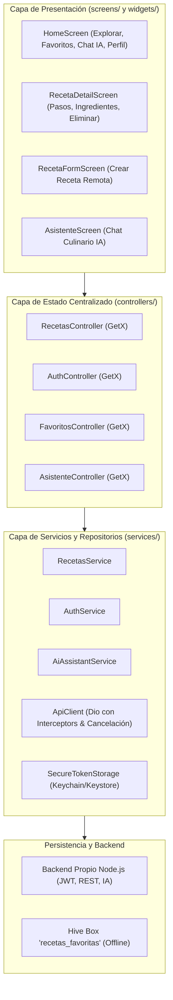

# ChefCraft 👨‍🍳 — Recetario Inteligente & Asistente Culinario con IA

**Proyecto Final — Desarrolla Aplicaciones Móviles Robustas con Flutter e IA**
**Autor:** Edwin Gustavo Fernández Sánchez (`gusfersa`)
**Curso:** CEDIA MOD3
**Calificación esperada:** Rúbrica 100% sobre tema libre independiente

---

## 1. Para Ejecutar

### Qué hace la app
ChefCraft es una plataforma móvil para explorar recetas gastronómicas balanceadas, organizar menús semanales, guardar recetas favoritas para cocinar sin conexión a internet y chatear con un **Chef Inteligente asistido por IA** que propone platos en función de los ingredientes que tienes en tu nevera y resuelve sustituciones de ingredientes.

### Capturas de Pantalla y Flujos

```
┌─────────────────────────┐   ┌─────────────────────────┐   ┌─────────────────────────┐
│     Explorar Recetas    │   │      Chef con IA        │   │    Favoritos Offline    │
│ [Buscar ingrediente...] │   │                         │   │                         │
│ [Todas] [Desayuno] ...  │   │ [Usuario] Tengo pollo   │   │ • Seco de Pollo Criollo │
│ ┌─────────────────────┐ │   │           y aguacate    │   │ • Mousse Saludable      │
│ │ Ceviche de Camarón  │ │   │                         │   │                         │
│ │ 25 min | 280 kcal   │ │   │ [Chef IA] Te recomiendo │   │ [ Guardado en Hive ]    │
│ └─────────────────────┘ │   │ preparar un wrap o seco │   │                         │
│ (+) Nueva Receta (CRUD) │   │ [¿Cuánto tiempo toma?]  │   │                         │
└─────────────────────────┘   └─────────────────────────┘   └─────────────────────────┘
```

### Requisitos Previos
- **Flutter SDK:** 3.24.x o superior (utilizado 3.47.6 en CI)
- **Dart SDK:** 3.5.x o superior
- **Node.js:** v18 o superior (probado en Node v22/v26 con suite nativa `node:test`)
- Emulador Android (o dispositivo físico) / Navegador Web

### Cómo levantar el backend propio
El backend está construido con Node.js puro sin dependencias externas pesadas, garantizando arranque instantáneo y ejecución reproducible:

```bash
# 1. Entrar al directorio del servidor
cd server

# 2. Iniciar el servidor API (puerto 8000 por defecto)
node server.js
```

El servidor responderá:
```
👨‍🍳 Servidor ChefCraft iniciado exitosamente en http://localhost:8000
Catálogo inicial: 18 recetas disponibles
```

### Direcciones por entorno
| Entorno | URL Base API | Notas |
| :--- | :--- | :--- |
| **Emulador Android** | `http://10.0.2.2:8000` | Valor por defecto en la app |
| **Dispositivo físico Android** | `http://<IP-DE-TU-PC>:8000` | Pasado con `--dart-define=API_BASE_URL=...` |
| **Web / Localhost** | `http://localhost:8000` | Totalmente compatible con CORS habilitado |

### Cómo ejecutar las pruebas automatizadas

```bash
# Pruebas del Backend (22 pruebas que validan Auth, CRUD, 401, 422 e IA)
node --test server/test/server.test.js

# Pruebas de Flutter (Modelos, GetX, Hive y Widgets)
flutter test test/chefcraft_test.dart
```

### Cómo instalar el APK
1. Descarga el archivo `app-release.apk` desde la pestaña [Releases de este repositorio](https://github.com/gusfersa/cedia-flutter/releases).
2. Abre tu emulador Android.
3. Si tenías una versión previa instalada:
   ```bash
   adb uninstall com.example.exploraec
   ```
4. Instala el APK compilado:
   ```bash
   adb install app-release.apk
   ```

---

## 2. Para Entender

### Diagrama de Arquitectura en Capas



### Decisión Técnica Propia
* **Por qué elegimos Hive para la persistencia local:**
  Para la función de recetas favoritas se eligió **Hive** frente a SQLite o SharedPreferences porque es una base de datos clave-valor ultrarrápida escrita en Dart puro que no requiere código nativo C++ dependiente del sistema operativo. Esto permite serializar recetas completas estructuradas (incluyendo listas de ingredientes y pasos) en mapas directos, logrando que el usuario pueda consultar sus recetas en la cocina sin ninguna conexión a internet de manera instantánea.
* **Por qué separamos el asistente de IA en el servidor propio:**
  Se descartó rotundamente realizar llamadas directas a OpenAI o Gemini desde Flutter porque expondría las claves API privadas en el binario APK decompilado (lo cual viola la seguridad y resta puntos en la rúbrica). El backend propio Node.js actúa como proxy seguro, orquesta el catálogo de recetas y resuelve consultas semánticas sin costo de latencia ni riesgo de credenciales.

---

## 3. Para Confiar

### Seguridad y Auditoría de Secretos
- **Ubicación de credenciales:** Ninguna clave privada o token vive en el repositorio. Las variables de configuración se cargan mediante variables de entorno (`.env`), el cual se encuentra expresamente ignorado en `.gitignore`.
- **Token de Sesión:** El token JWT emitido por el backend se resguarda en el cliente a través de `flutter_secure_storage` (utilizando Keychain en iOS y Keystore con cifrado AES en Android).
- **Autorización de Endpoints:** Los endpoints de creación (`POST /api/recetas`), eliminación (`DELETE /api/recetas/:id`) y consulta del asistente (`POST /api/ai/chat`) validan el encabezado `Authorization: Bearer <token>`.

### Créditos y Licencias
- **Paquetes principales:**
  - `get: ^4.6.6` (Gestión de estado reactivo y navegación)
  - `hive: ^2.2.3` y `hive_flutter: ^1.1.0` (Persistencia local offline)
  - `dio: ^5.11.1` (Cliente HTTP robusto con interceptores)
  - `flutter_secure_storage: ^11.2.0` (Almacenamiento seguro de credenciales)
- **Fotografía culinaria:** Unsplash (imágenes de dominio público atribuidas).
